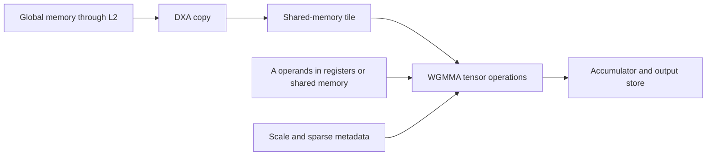

# Blackwell-inspired compute studies

Run and inspect Vortex kernels for low-precision matrix arithmetic, block
scaling, structured sparsity, shared-memory operands, asynchronous copy and
integer atomics. The launcher uses the existing C++ kernels and their CPU
references; the source links below are the actual device implementations.
CPU work verifies results and performs host packing/scaling.

This is a compact Vortex study machine, with eight threads per warp and eight
warps in the `ypcb_blackwell_like` profile. It does not execute CUDA binaries
or implement Blackwell TMEM/`tcgen05`. Its memory remains YPCB CH1 DDR3, rather
than a model of a commercial GPU's physical memory system.

## Run

From a configured RV32, 2 GiB build with the native toolchain installed:

```bash
../configure --xlen=32 --memory-size=2147483648 --tooldir="$HOME/tools" --profile=ypcb_blackwell_like
./ci/ypcb_env.sh exec make -j1 -C examples/blackwell_like list
./ci/ypcb_env.sh exec make -j1 -C examples/blackwell_like run CASE=fp8 DRIVER=simx
./ci/ypcb_env.sh exec make -j1 -C examples/blackwell_like run CASE=nvfp4 DRIVER=xrt
```

For dimensions, an output directory or all cases:

```bash
./ci/ypcb_env.sh exec python3 ../examples/blackwell_like/study.py --case wgmma --driver xrt -m16 -n32 -k64
./ci/ypcb_env.sh exec python3 ../examples/blackwell_like/study.py --case all --driver simx
```

The default GEMM is M=16, N=16, K=64. Tile geometry depends on the configured
thread count and datatype; the C++ programs reject dimensions that do not fit.
In the eight-thread study profile, FP4 needs K to be a multiple of 64.
Every run records the profile, application flags, arguments, binary hashes,
numerical output and GPU counters in a fresh directory under the build tree.
Builds use `THREADS`, defaulting to the host CPU count. Set `THREADS=1` for a
smaller worker limit. The selected driver defaults to SimX even when a prior
shell set `VORTEX_DRIVER`.

SimX is the software model. XRT selects full GPU/AFU RTL simulation here.
For physical execution, select `DRIVER=ypcb` only after the matching image has
been qualified and programmed, the image-bound runtime has been prepared and
the board owner has released access. The launcher uses an existing connection;
it does not program the FPGA or start JTAG servers. Respect the shared board's
JTAG lease and OpenTPU priority.

## Reading order and kernels

| Case | Study | Device source |
|---|---|---|
| `fp16`, `bf16` | FP32 accumulation from 16-bit inputs | [Dense tensor GEMM](../../tests/regression/sgemm_tcu/kernel.cpp) |
| `int8`, `uint8` | INT32 accumulation from packed integer inputs | [Dense tensor GEMM](../../tests/regression/sgemm_tcu/kernel.cpp) |
| `tf32`, `fp8`, `bf8` | Precision, packing and numerical error | [Dense tensor GEMM](../../tests/regression/sgemm_tcu/kernel.cpp) |
| `mxfp8`, `mxbf8` | Block scaling and scale metadata | [Scaled GEMM](../../tests/regression/sgemm_tcu_mx/kernel.cpp) |
| `mxfp4`, `nvfp4` | Four-bit values and block/tensor scales | [Scaled GEMM](../../tests/regression/sgemm_tcu_mx/kernel.cpp) |
| `sparse`, `sparse-mx` | Compressed operands and structured-sparsity metadata | [Sparse GEMM](../../tests/regression/sgemm_tcu_sp/kernel.cpp), [sparse/scaled GEMM](../../tests/regression/sgemm_tcu_sp_mx/kernel.cpp) |
| `wgmma`, `wgmma-mx` | A/B tiles from shared memory | [WGMMA](../../tests/regression/sgemm_tcu_wg/kernel.cpp), [scaled WGMMA](../../tests/regression/sgemm_tcu_wg_mx/kernel.cpp) |
| `copy`, `multicast` | Descriptor-driven global-to-shared transfers | [Copy](../../tests/regression/dxa_copy/kernel.cpp), [multicast](../../tests/regression/dxa_copy_mcast/kernel.cpp) |
| `pipeline`, `sparse-pipeline` | Feeding a tensor kernel with DXA transfers | [Dense pipeline](../../tests/regression/sgemm_tcu_wg_dxa/kernel.cpp), [sparse pipeline](../../tests/regression/sgemm_tcu_wg_sp_dxa/kernel.cpp) |
| `atomics` | Contention, read-modify-write operations and CAS | [Atomic operations](../../tests/regression/amo/kernel.cpp) |
| `cache-reuse` | Repeated GEMM baseline for cache-configuration comparisons | [Dense tensor GEMM](../../tests/regression/sgemm_tcu/kernel.cpp) |

The dense programs verify two launches. The other programs perform their own
reference checks. Each case needs numerical success, a zero exit status and
positive GPU retirement counters. Read each directory's `main.cpp` for input
generation, reference calculations and the precise error criterion.



MXFP8/MXBF8 use scales for blocks of 32 values. MXFP4 also uses blocks of 32;
NVFP4 uses blocks of 16 and the example enables its software tensor-level
scale. Packing, scale conversion and tensor geometry are in
[tensor_cfg.h](../../sw/common/tensor_cfg.h),
[tensor_mx.h](../../sw/runtime/include/tensor_mx.h) and
[vx_tensor.h](../../sw/kernel/include/vx_tensor.h).

For cache studies, compare the recorded cycle series and memory counters using
separate configured profiles, holding other geometry and datatypes fixed.
Changing L2, geometry or pipeline parameters
requires matching software and a new FPGA image. Simulator results and
configured bandwidth figures are distinct from physical GPU measurements.
